# Lakehouse Medallion PoC: Sales Analytics & Inventory Forecast on Databricks

End-to-end data engineering proof of concept built on **Databricks (Free Edition)**: a messy sales CSV goes through a **Bronze → Silver → Gold** medallion pipeline with data-quality rules, quarantine, LGPD-compliant handling of personal data, a star schema for BI, observability tables and a **3-month demand forecast with inventory recommendation**, all governed in **Unity Catalog**.


> Code, table names and comments are in Portuguese (the original challenge was in Brazilian Portuguese). This README is in English.

---

## The problem

Historical sales of three products (Notebook, Smartphone, Smartwatch) arrive as a single CSV with **101,000 rows** and the usual real-world issues:

- dates in **three mixed formats** per column (`yyyy-MM-dd`, `dd/MM/yyyy`, `MM-dd-yyyy`, and different ones for pickup date)
- typos in product names (`Not-book`, `Smart phon`, `Smart watchi`) and inconsistent casing in statuses and cities
- state field with full names, misspellings and **states that contradict the city** (`Salvvador`, `Rio janeiro`, `Amazonas` for São Paulo)
- **1,000 exact duplicates**, malformed CPFs (`11 digits + X`, `123`), invalid e-mails, negative quantities and prices
- personal data (CPF, phone, e-mail) stored in clear text

The goal: deliver trusted analytics and a stock-planning number for the next quarter.

## Architecture

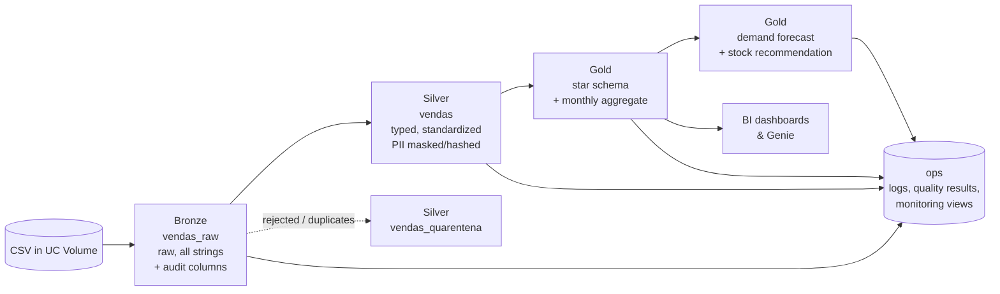

| Layer | What happens |
|---|---|
| **Bronze** | Faithful copy of the source (everything as string), schema contract check, standardized column names, audit columns (`_arquivo_origem`, `_data_ingestao`, `_id_lote`, `_numero_linha_origem`) |
| **Silver** | Dictionary-based standardization, multi-format date parsing guarded by regex, type casting with `try_cast`, city→state correction, deduplication after normalization, **19 data-quality rules** (5 blocking errors → quarantine, 14 warnings tracked per row) |
| **Gold** | Star schema (`fato_vendas` + 6 dimensions, incl. a role-playing date dimension and a junk status dimension), monthly product aggregate, denormalized analytic view, **6 integrity checks** (G01–G06) |
| **Forecast** | Backtest of 8 baseline models, model selection by parsimony, 80% prediction intervals, safety stock at a 95% service level |
| **ops** | Execution log, record funnel, quality results per rule and monitoring views |

### Orchestration

The pipeline runs as a **Databricks Job** (`pipeline_vendas_estoque`), defined as code and deployable with **Databricks Asset Bundles**:


Each task is a notebook, and a failure in any layer stops the downstream tasks. Profiling (`02`), monitoring views (`05`) and charts (`06`) are run on demand and stay outside the scheduled job.

## Results

**Record funnel (fully reconciled: Bronze = Silver + quarantine + duplicates)**

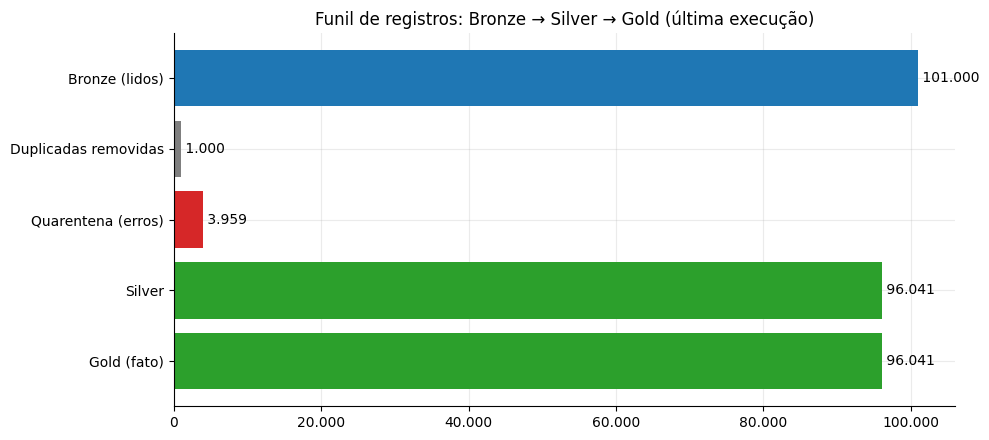

| Metric | Value |
|---|---|
| Raw rows | 101,000 |
| Duplicates removed | 1,000 |
| Quarantined (blocking rule violations) | 3,959 |
| Rows in Silver / Gold fact | 96,041 |
| Gold integrity checks passing | 6 / 6 |

**Business KPIs (approved sales)**: net revenue of **R$ 224.8 M**, 31,480 approved sales, average ticket of R$ 7,140.58, discounts at 13.8% of gross revenue and a **32.7% cancellation rate**.

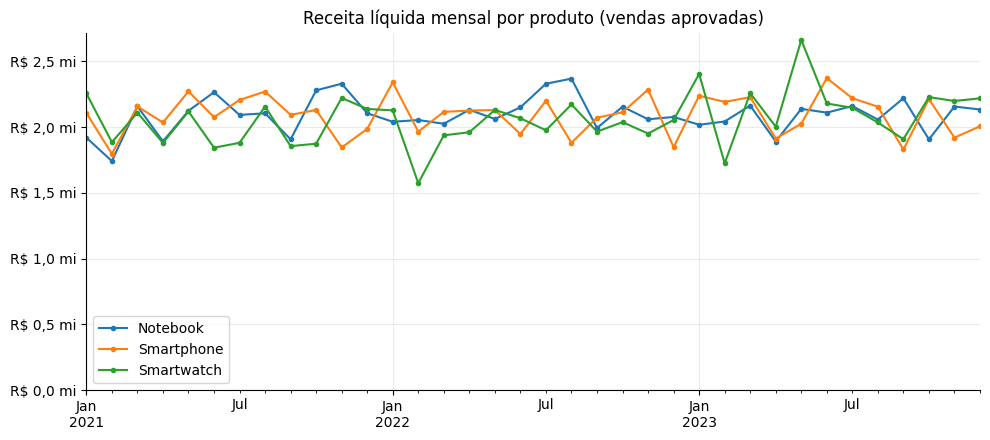

**Demand forecast (Jan–Mar 2024)**: series analysis showed no relevant autocorrelation or seasonality (ACF within the white-noise band), so the simplest model within 0.5 p.p. of the best WAPE was chosen: the historical mean, with **WAPE of 4.86%** in an expanding-window backtest (10 cut-offs × 3 months × 3 products). The 80% interval covers 81–83% of historical months, which validates its calibration.

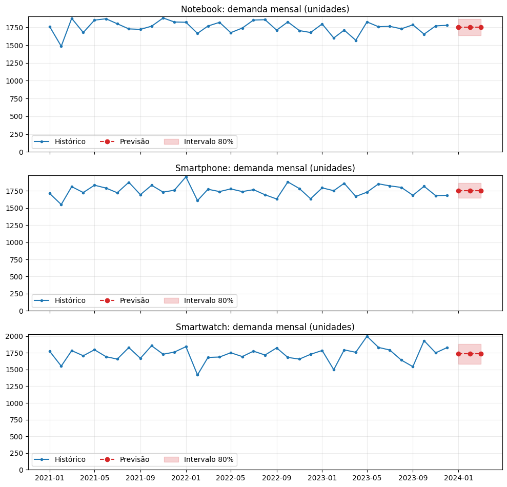

| Product | Forecast demand (3 months) | Safety stock (95%) | Recommended stock |
|---|---:|---:|---:|
| Notebook | 5,258 | 259 | 5,517 |
| Smartphone | 5,266 | 244 | 5,510 |
| Smartwatch | 5,203 | 329 | 5,533 |

<details>
<summary>More charts</summary>

| | |
|---|---|
| 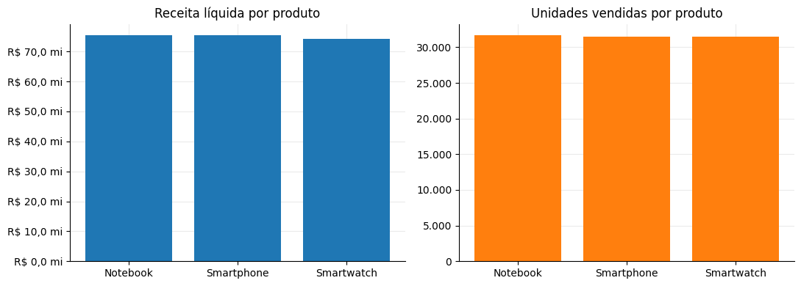 | 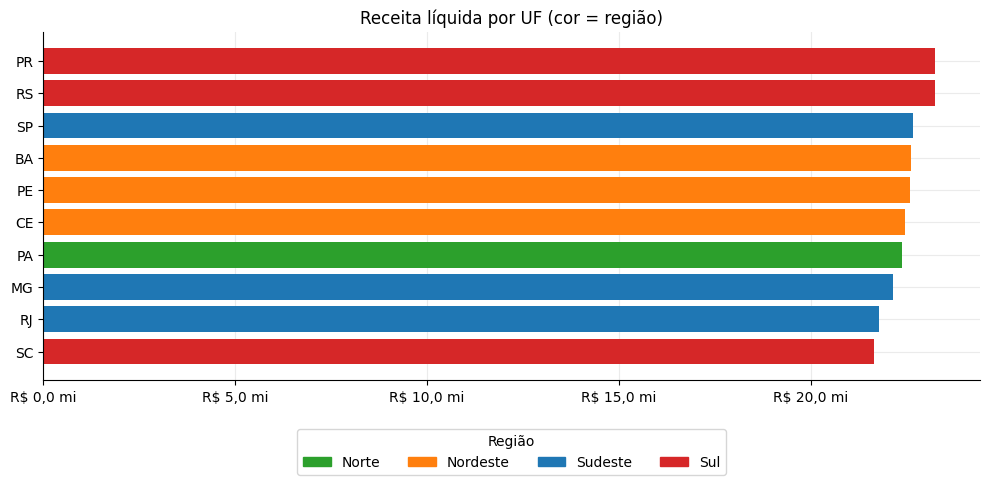 |
| 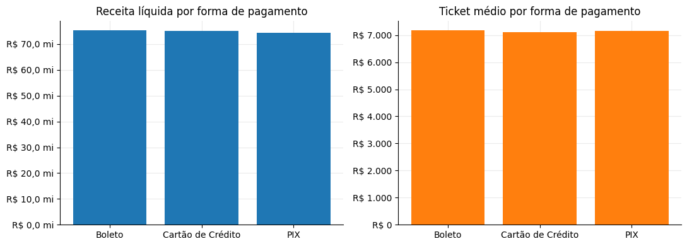 | 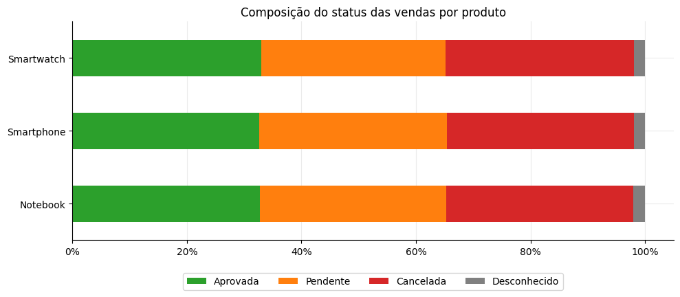 |
| 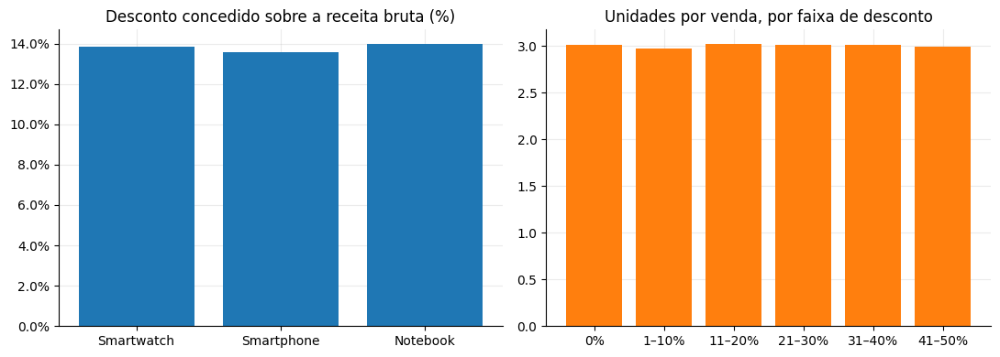 | 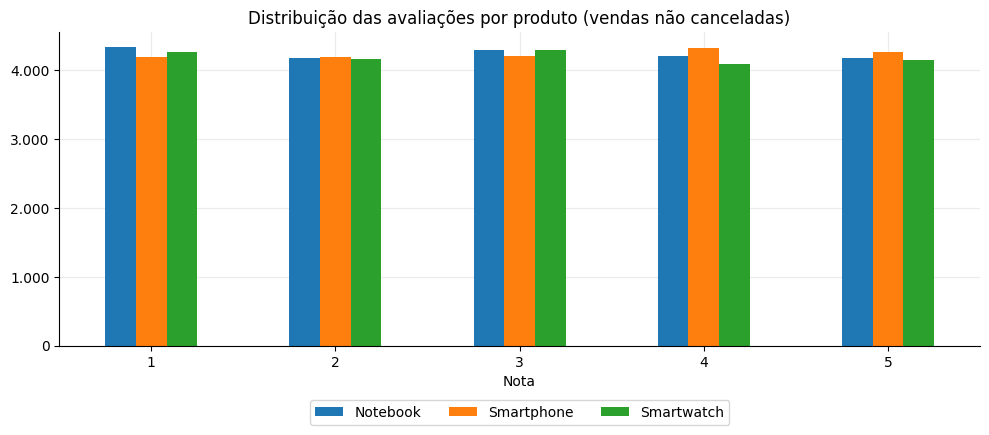 |
| 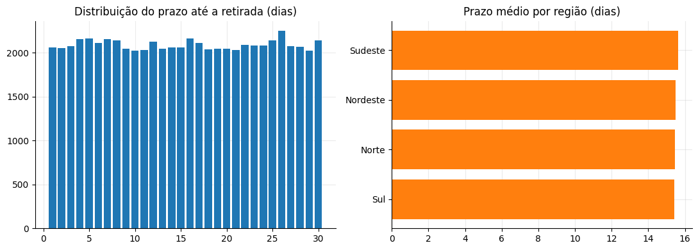 | 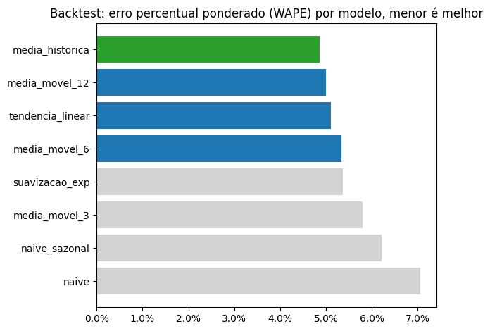 |
| 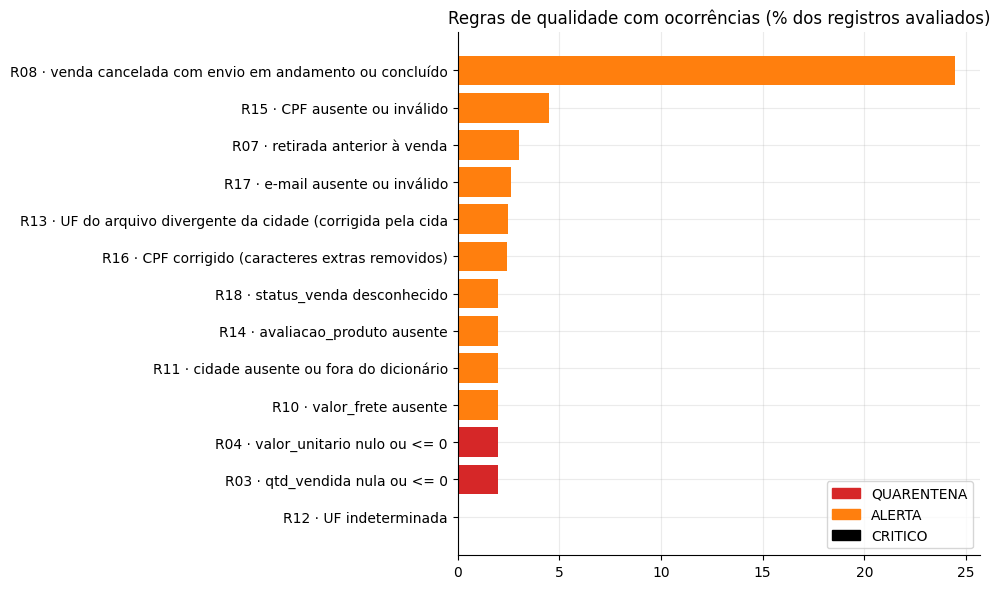 | 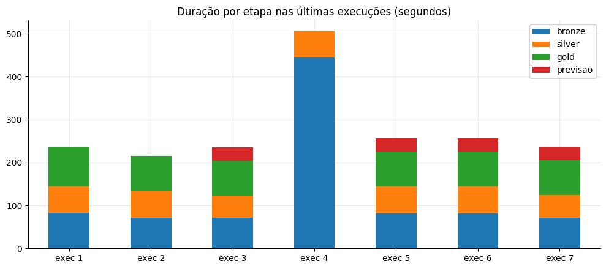 |

</details>

## Data quality & observability

- **Rules as data**: each rule is an `(id, description, condition, severity)` tuple. Errors send the row to quarantine with the violated rule IDs, and warnings travel with the row in an `alertas` array column.
- Results per rule and per run are appended to `ops.qualidade_resultados`; volumes per layer go to `ops.log_pipeline`.
- Monitoring views: last execution, execution history, record funnel, latest status per rule (`OK / QUARANTINE / WARNING / CRITICAL`) and an overall quality score.
- Every pipeline notebook ends with `dbutils.notebook.exit(...)` returning batch ID, rows read/written/rejected/duplicated and status, which makes each job task's result readable in the run output.

## Governance & privacy (LGPD)

- **Silver and Gold contain no personal data in clear**: CPF is kept as a masked value (`***.***.***-DD`) and a **salted SHA-256 hash** (count distinct customers without exposing the CPF); phone and e-mail are masked.
- **Unity Catalog column masks** on the Bronze PII columns: only the pipeline owner and an authorized group see clear values.
- Table and column **comments with lineage rules** ("source / rule") for every column, **tags** (`camada`, `dominio`, `contem_pii`, `classificacao`) and informational **primary/foreign keys** on the star schema, which help the Genie space understand the joins.
- Access model: engineering on all layers, while analysts, BI and Genie see Gold only.

## Repository structure

```
databricks.yml                          # Databricks Asset Bundle config
resources/
└── pipeline_vendas_estoque.job.yml     # job definition: bronze → silver → gold → previsao → governanca
notebooks/
├── 00_prepara_ambiente.ipynb          # catalog, schemas and volume
├── 01_bronze_ingestao.ipynb           # CSV → Bronze with schema contract and audit columns
├── 02_bronze_analise.ipynb            # data profiling that drove the Silver rules
├── 03_silver_tratamento.ipynb         # standardization, 19 quality rules, quarantine, PII masking
├── 04_gold_modelagem.ipynb            # star schema, monthly aggregate, analytic view, G01–G06 checks
├── 05_observabilidade.ipynb           # monitoring views over the ops schema
├── 06_indicadores_visualizacoes.ipynb # KPIs and charts
├── 07_previsao_demanda.ipynb          # backtest, forecast and stock recommendation
└── 08_governanca_metadados.ipynb      # comments, tags, PK/FK, column masks, grants
docs/images/                            # charts exported by notebooks 06 and 07
```

## How to run

1. Import the `notebooks/` folder into a Databricks workspace (Free Edition works) with Unity Catalog enabled.
2. Run `00_prepara_ambiente` to create the `desafio_vendas` catalog, the schemas and the `bronze.origem` volume.
3. Upload the source file `Dataset_vendas_1.csv` to `/Volumes/desafio_vendas/bronze/origem/` (the dataset belongs to the challenge and is not distributed in this repository).
4. Deploy and run the job with the Databricks CLI:
   ```bash
   databricks bundle deploy -t dev
   databricks bundle run pipeline_vendas_estoque -t dev
   ```
   Or run notebooks `01` → `08` manually, in order.

## Design decisions worth noting

- **Bronze keeps everything as string**: no data is lost at ingestion, and all typing happens in Silver with `try_cast`, so bad values become rule violations instead of job failures.
- **Date parsing guarded by regex**: each format is only applied to values matching its pattern, which avoids silent misreadings between `dd-MM` and `MM-dd`. The profiling notebook proves which format each column actually uses.
- **City is the source of truth for the state**: on rows with a clean state, each city maps to exactly one state, so the city fixes misspelled or contradictory states (flagged as rule R13).
- **Deduplication after normalization**, not on raw text, so `Not-book` and `Notebook` are recognized as the same sale.
- **Parsimony over complexity in forecasting**: with no temporal signal in the data, a simple mean beats trend and naive models and is easier to explain to the business.

---

Author: **John Serafim**, Databricks Certified Data Engineer Associate · [LinkedIn](https://www.linkedin.com/in/johnserafim)
